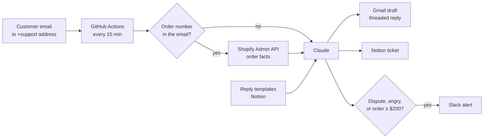

# Shopify Support Triage

An AI assistant for a store's support inbox. Every 15 minutes it reads new customer emails, sorts them, looks up the order in Shopify, and drafts a reply in Gmail for a human to review. Every email becomes a ticket in Notion, and disputes, angry customers and high-value orders ping Slack straight away.

**It never sends anything on its own.** Replies wait as Gmail drafts until a person approves them.


Project 3 of an e-commerce automation portfolio by **Riad Mrad**:
[1. Sales Alerts](https://github.com/riadmrad1992-blip/shopify-sales-alerts) ·
[2. Profit Dashboard](https://github.com/riadmrad1992-blip/shopify-profit-dashboard) ·
3. Support Triage

---

## What happens to each email



| Field | Values |
|---|---|
| Category | Refund · Shipping · Dispute · Product question · Order change · Other |
| Urgency | High · Normal · Low |
| Sentiment | Angry · Frustrated · Neutral · Happy |
| Escalates to Slack when | Dispute, angry customer, high urgency, or order total ≥ $200 |

The draft uses real order facts (items, payment and fulfillment status) and follows the store's own reply templates for tone and structure.

## Safety by design

- **Human in the loop.** Drafts only; nothing is sent automatically.
- **Prompt-injection aware.** Customer emails are passed to the model as data, and the system prompt tells it never to follow instructions found inside them. Output is parsed as strict JSON and validated against fixed category lists.
- **No promises the data can't back.** The model is told not to promise refunds or discounts; those decisions stay with a person.
- **Fails safe.** If the AI call fails, keyword rules classify the email and a neutral holding reply is drafted, so no customer is left without a response. One bad email never blocks the rest, and failures alert Slack.
- **Processed once.** Each email gets a Gmail `Triaged` label, and runs never overlap.
- **Emails stay unread** in Gmail, so the support person still sees them.

## Setup

1. **Gmail:** an app password (Google Account → Security → App passwords). The support address can be a `+support` alias of the same inbox.
2. **Claude API key** from console.anthropic.com. The default model is the fast, low-cost Haiku tier; set `ANTHROPIC_MODEL` to change it.
3. **Shopify app** with `read_orders` (same app as projects 1 and 2).
4. **Notion:** create an internal integration at notion.so/my-integrations, then share the **Support Tickets** database (and your reply-template database, if you use one) with it via **⋯ → Connections**.
5. **GitHub secrets:** `GMAIL_ADDRESS`, `GMAIL_APP_PASSWORD`, `SUPPORT_ADDRESS`, `ANTHROPIC_API_KEY`, `SHOPIFY_STORE`, `SHOPIFY_CLIENT_ID`, `SHOPIFY_CLIENT_SECRET`, `NOTION_TOKEN`, `NOTION_TICKETS_DB`, plus optional `NOTION_TEMPLATES_DB` and `SLACK_WEBHOOK_URL`.

### Reply templates

The live system reads reply templates from a Notion database with `Scenario`, `Category` and `Script` columns. Without one, it uses the generic samples in `sample_templates.json`.

### Try it

```bash
python send_test_emails.py --order "#1012"   # 5 realistic customer emails to your support address
python triage.py --dry-run                   # see how they'd be classified, change nothing
python triage.py                             # drafts + Notion tickets + Slack alerts
python -m unittest discover -s tests -v      # 18 tests, no network needed
```

## Project structure

```
triage.py               # the pipeline: Gmail, Shopify, Claude, Notion, Slack
triage_core.py          # pure logic: parsing, order numbers, escalation, payloads (unit-tested)
sample_templates.json   # generic reply templates (fallback)
send_test_emails.py     # demo emails
tests/                  # unit tests + an end-to-end test with fake services
.github/workflows/      # every-15-minute run, tests on push
```
